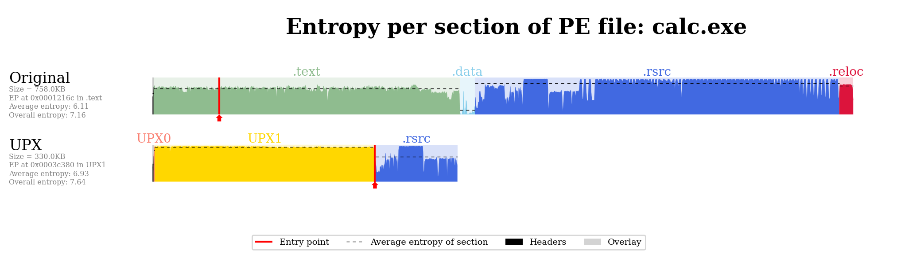

# Bintropy

<p align="center"></p>

**Bintropy** estimates how likely a binary is to contain compressed or
encrypted bytes, which is a strong hint that it is packed. It implements the
entropy-based analysis tool of Lyda and Hamrock,
[*Using Entropy Analysis to Find Encrypted and Packed Malware*](https://ieeexplore.ieee.org/document/4140989),
as a Python package with a console script.

[](https://pypi.python.org/pypi/bintropy/)
[](https://pypi.python.org/pypi/bintropy/)
[](https://github.com/packing-box/bintropy/actions/workflows/python-package.yml)
[](https://github.com/packing-box/bintropy/actions/workflows/security.yml)
[](https://zenodo.org/badge/latestdoi/382563382)
[](https://pypi.python.org/pypi/bintropy/)

## Features

- **The two criteria of the paper** (see [How it works](internals.md)): a
  binary is packed when both its average block entropy and its highest block
  entropy reach a threshold.
- **Three modes of operation**: the whole binary and per section, as in the
  paper, plus per segment.
- **Three executable formats**: PE, ELF and Mach-O, parsed with
  [LIEF](https://github.com/lief-project/LIEF).
- **Configurable**: block size, thresholds and the handling of blocks that are
  mostly zeros (or mostly one byte).
- **Plots** of the entropy along the binary, with its sections and entry point.
- **A command-line tool**, [`bintropy`](cli/bintropy.md), and a
  [Python API](api.md).

## Quick start

```console
$ pip install bintropy
$ bintropy /bin/ls
False
$ bintropy /bin/ls --do-not-decide
5.932568219905103 4.324928827302256
```

From Python:

```python
from bintropy import bintropy

print(bintropy("program.exe"))                # True or False
print(bintropy("program.exe", decide=False))  # (highest block entropy, average block entropy)
```

With `--plot`, Bintropy draws the entropy of the binary along its sections:



## Related projects

Bintropy is part of the [packing-box](https://github.com/packing-box) ecosystem:

- [Awesome Executable Packing](https://github.com/packing-box/awesome-executable-packing): a curated list of resources about executable packing.
- [Dataset of packed ELF files](https://github.com/packing-box/dataset-packed-elf) and [Dataset of packed PE files](https://github.com/packing-box/dataset-packed-pe).
- [Docker Packing Box](https://github.com/packing-box/docker-packing-box): a Docker image of packers and tools for building datasets of packed executables.
- [DSFF](https://github.com/packing-box/python-dsff): the DataSet File Format library.
- [PEiD](https://github.com/packing-box/peid): a Python implementation of the Packed Executable iDentifier.
- [PyPackerDetect](https://github.com/packing-box/pypackerdetect): a packing detector for PE files using several heuristics and PEiD signatures.
- [REMINDer](https://github.com/packing-box/reminder): a packing detector using a simple heuristic on the entry point section.

## License

Bintropy is released under the
[GNU General Public License v3 or later](https://www.gnu.org/licenses/gpl-3.0.html).
